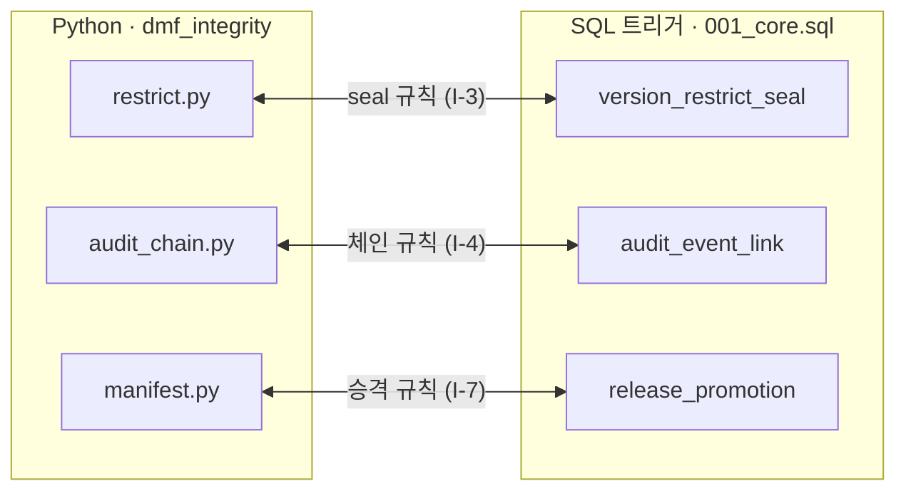

# DMF — 작업 규칙

설계의 원본은 `docs/ARCHITECTURE.md`입니다. 불변 규칙은 **I-1~I-7**, 해시 규칙은 **H-1~H-8** 번호로 고정되어 있으며, 코드 주석·리뷰·커밋 메시지에서 번호로 참조합니다. 번호가 붙은 규칙을 바꾸려면 설계 문서를 먼저 수정합니다.

## 문서 작성 규칙
- README.md 등 설명용 텍스트 파일은 **한국어**로 작성합니다.
- 흐름·구조 도형은 **Mermaid**, 표 형태는 **마크다운 표**로 작성합니다. 박스 문자로 그린 도형은 한글 폭 때문에 깨지므로 쓰지 않습니다 (디렉터리 트리는 예외).
- Mermaid 라벨은 `["..."]`처럼 따옴표로 감싸고, 줄바꿈은 ` `을 씁니다. 라벨 안에 `#`과 `;`는 쓰지 않습니다.

## 절대 규칙

| ID | 규칙 |
|---|---|
| I-1 | 엔터티는 불변. 버전·모듈 리비전·승인·결정·검증 결과·정책·감사 로그에 UPDATE/DELETE 경로를 만들지 않는다 → 항상 새 행을 추가 |
| I-2 | 문서 head는 `dmf.advance_head()` CAS로만 이동. `UPDATE document SET head_version_id` 직접 실행 금지 |
| I-6 | 승인·검증은 `manifest_root`에 고정 |
| I-7 | Shadow와 Official의 `manifest_root`가 같아야 승격 가능 |
| H-1 | 해시는 `canonicalize()`(JCS)로 만든 바이트에만. 해시 대상에 float 금지 |
| H-2 | 머클은 RFC 6962 호환 유지 (leaf 0x00 / node 0x01, 2의 거듭제곱 분할) |
| H-8 | 새로 해시하는 페이로드에는 `"t": "dmf.<이름>/v1"` 태그를 붙인다 |

## 이중 강제 구조

같은 규칙을 앱과 DB가 각각 강제합니다. 한쪽을 바꾸면 반드시 다른 쪽도 함께 바꿉니다.

## 명령어
- 테스트: `PYTHONPATH=src python3 -m unittest discover -s tests -v` (표준 라이브러리만 사용)
