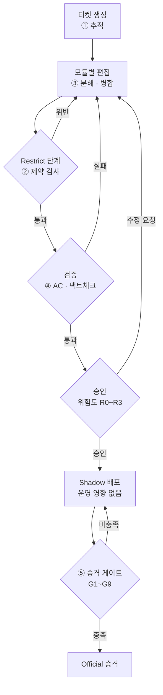
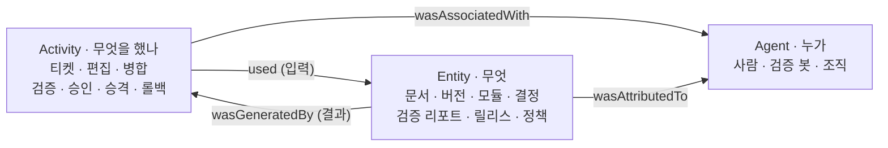
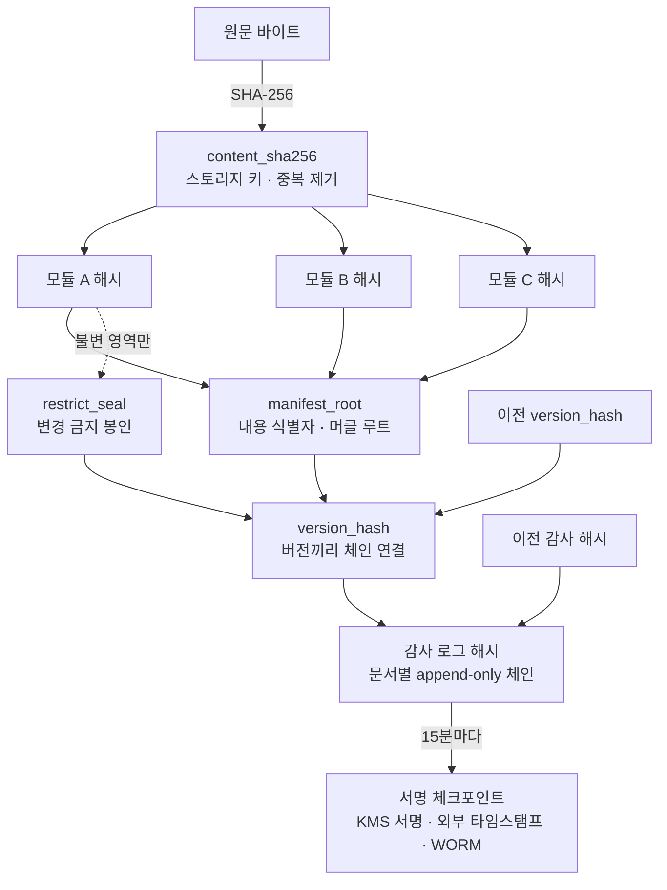
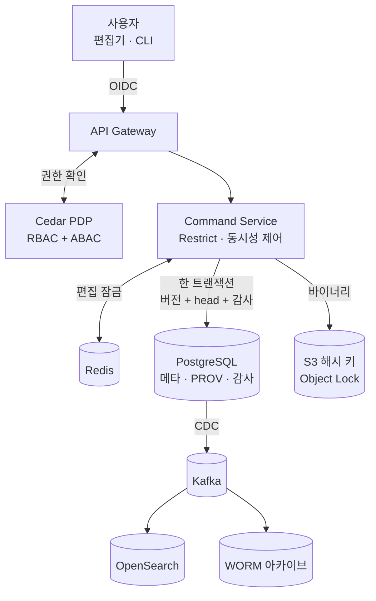

# DMF — 엔터프라이즈 문서 관리 프레임워크

여러 작업자가 동시에 문서를 열람·수정·승인하는 환경에서, **누가 · 언제 · 무엇을 · 왜** 바꿨는지 끝까지 추적하고, 바뀌면 안 되는 부분은 수학적으로 잠그고, 검증된 내용만 공식 배포하는 문서 관리 프레임워크입니다.

참조 표준: W3C PROV-DM/PROV-O · Dublin Core · OASIS CMIS 1.1 · RFC 8785(JCS) · RFC 6962/9162(머클 트리) · RFC 3161(타임스탬프)

> 상세 설계는 [docs/ARCHITECTURE.md](docs/ARCHITECTURE.md), 사용법은 [docs/USAGE.md](docs/USAGE.md)를 보십시오.
>
> 도형은 Mermaid로 작성되어 있습니다. GitHub에서는 바로 보이고, VSCode 미리보기에서는 [Markdown Preview Mermaid Support](https://marketplace.visualstudio.com/items?itemName=bierner.markdown-mermaid) 확장이 필요합니다.

---

## 한눈에 보기 — 문서 하나의 일생

①~⑤는 5대 핵심 요구사항입니다.



---

## 5대 요구사항과 구현 위치

| # | 요구사항 | 핵심 메커니즘 | 구현 파일 |
|---|---|---|---|
| ① | 티켓 추적·승인 거버넌스 | 티켓 = PROV Activity, 위험도 R0~R3별 승인 정족수 | [001_core.sql](schema/postgres/001_core.sql), [approval-policy.yaml](policies/approval-policy.yaml) |
| ② | Restrict 단계 | 불변/제한/가변 3영역, 불변 영역 봉인(`restrict_seal`) | [restrict.py](src/dmf_integrity/restrict.py), [restrict-policy.yaml](policies/restrict-policy.yaml) |
| ③ | 원자적 분해·병합·롤백 | 모듈 단위 3-way 병합, 롤백 = 과거 내용의 새 버전 | [merge.py](src/dmf_integrity/merge.py), [manifest.py](src/dmf_integrity/manifest.py) |
| ④ | 팩트체크·검증 | 자동/반자동 AC, 결과를 내용 해시에 고정 | [acceptance-criteria.yaml](policies/acceptance-criteria.yaml) |
| ⑤ | Shadow → Official | 게이트 G1~G9, "검증한 바이트 그대로 승격" | [gate-policy.yaml](policies/gate-policy.yaml), DB 트리거 `release_promotion` |

---

## 데이터 모델 (W3C PROV 기준)

모든 것은 Agent(누가), Activity(무엇을 했나), Entity(무엇) 세 가지로 분류됩니다.



---

## 해시 무결성 구조

어느 층이든 1바이트가 바뀌면 그 위의 모든 해시가 달라지므로 변조가 드러납니다.



---

## 시스템 구성



---

## 디렉터리 구조

```
DMF/
├── README.md                 ← 이 문서
├── CLAUDE.md                 ← 작업 규칙 요약
├── docs/
│   ├── ARCHITECTURE.md       ← 상세 설계 (규칙 원본)
│   └── USAGE.md              ← 사용 가이드
├── schema/
│   ├── postgres/001_core.sql ← DB 스키마, 트리거, RLS
│   └── jsonld/               ← PROV · DC · CMIS 매핑
├── policies/                 ← 승인 · 제약 · 검증 · 승격 · 권한
├── src/dmf_integrity/        ← 해시 · 머클 · 병합 구현
└── tests/test_integrity.py   ← 단위 테스트
```

---

## 실행 방법

```bash
# 테스트 실행 (Python 3.9+, 외부 의존성 없음)
PYTHONPATH=src python3 -m unittest discover -s tests -v
```

```python
from dmf_integrity import ModuleRef, Mutability, build_version, content_sha256

core  = ModuleRef("core.rules", "section", Mutability.IMMUTABLE_CORE, 0,
                  content_sha256(b"규칙 1"))
intro = ModuleRef("sec.intro", "section", Mutability.MUTABLE, 1,
                  content_sha256(b"서론"))

v1 = build_version("doc-1", 1, None, [core, intro], {"dc:title": "보안 정책"})
print(v1.manifest_root, v1.version_hash)
```

자세한 단계별 사용법은 [docs/USAGE.md](docs/USAGE.md)에 있습니다.

---

## 현재 상태

| 구분 | 항목 |
|---|---|
| ✅ 완료 | 설계 문서, DB 스키마(구문 검증), 해시·머클·체인 구현과 테스트, 정책 파일 5종, 사용 가이드 |
| ⏳ 남은 작업 | PostgreSQL 실DB 적용 테스트, Cedar 정책 CLI 검증, Command Service API, 검증기(Verifier), LLM 연동용 MCP 서버 |
