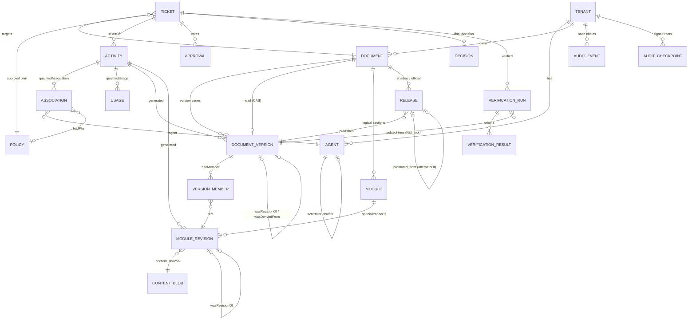
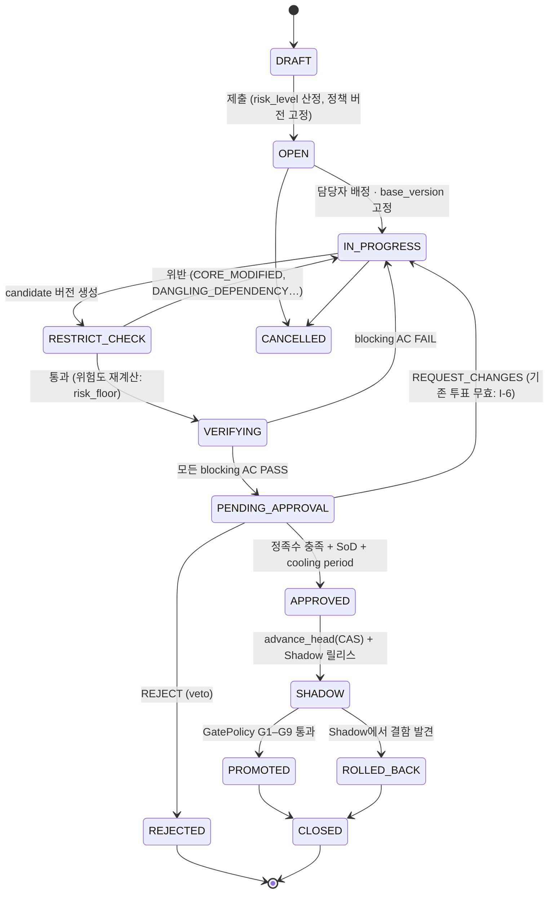
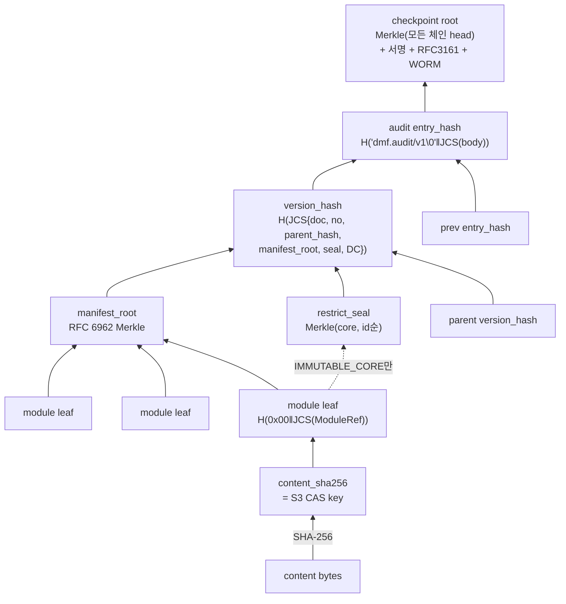
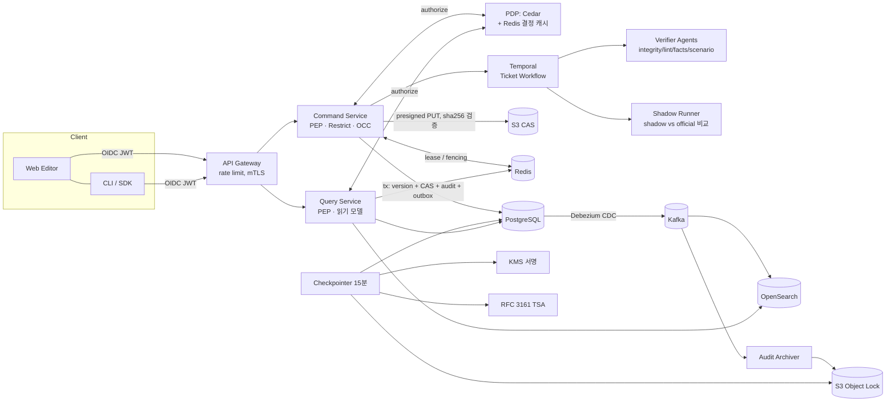
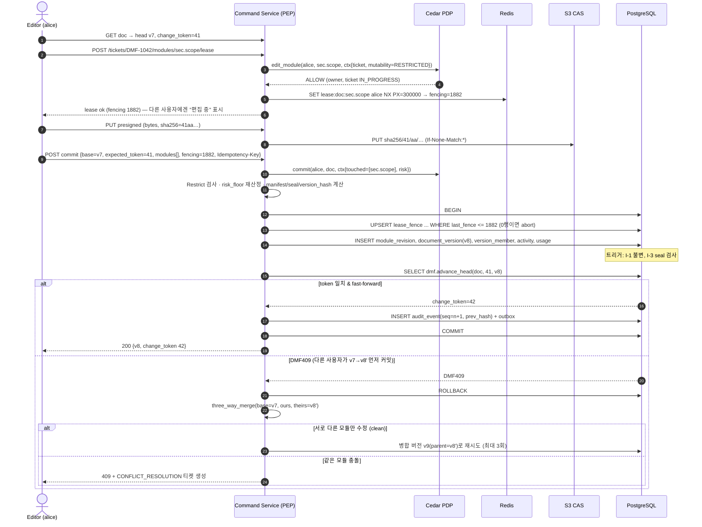
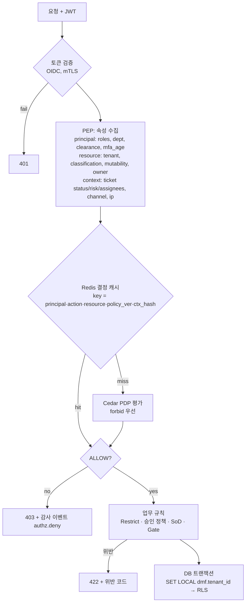
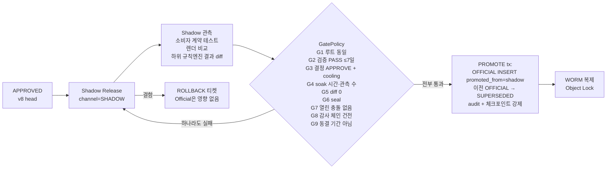

# DMF — 엔터프라이즈 문서 관리 프레임워크 설계서

> 상태: Draft v0.1 (2026-11-11) · 표준 기준: W3C PROV-DM/PROV-O, DCMI Terms, OASIS CMIS 1.1, RFC 8785(JCS), RFC 6962/9162(Merkle), RFC 3161(TSA)
>
> 이 문서는 **불변 규칙(Invariant)** 과 **해시 규칙(H-x)** 을 번호로 고정합니다. 이후 모든 설계·코드·리뷰는 번호로 이를 참조하며, 규칙 변경은 `POLICY_CHANGE` 티켓(R3)으로만 합니다.

---

## 0. 설계 원칙과 불변 규칙

| ID | 불변 규칙 | 강제 지점 |
|---|---|---|
| **I-1** | 엔터티(버전, 모듈 리비전, 결정, 검증 결과, 감사 로그, 정책)는 한 번 쓰이면 변경·삭제 불가. "수정"은 항상 새 엔터티 생성 | 서비스 + DB 트리거 `forbid_mutation` |
| **I-2** | 문서의 head 포인터는 `change_token` CAS(Compare-And-Swap)로만, fast-forward로만 이동 | `dmf.advance_head()` |
| **I-3** | `restrict_seal`(불변 코어의 머클 루트)은 승인된 `CORE_AMENDMENT` 티켓으로만 변경 | `restrict.check_restrictions` + 트리거 `version_restrict_seal` |
| **I-4** | 감사 로그는 append-only, 각 행은 직전 행의 해시에 연결 | `audit_chain.py` + 트리거 `audit_event_link` |
| **I-5** | 테넌트 간 데이터 접근 불가 | PostgreSQL RLS + Cedar `forbid` |
| **I-6** | 승인·검증·승격은 모두 특정 `manifest_root`에 바인딩. 내용이 1바이트라도 바뀌면 무효 | `approval.subject_manifest_root`, Gate G1 |
| **I-7** | Official로 승격되는 바이트 = Shadow에서 검증된 바이트 ("promote what you tested") | 트리거 `release_promotion` |

핵심 아이디어는 세 가지입니다.

1. **문서 = 콘텐츠 주소 지정(CAS) 모듈의 순서 있는 집합.** 원자적 분해·병합·롤백이 모두 "모듈 참조 목록(manifest)을 새로 만드는 일"로 환원됩니다.
2. **모든 행위 = PROV Activity, 모든 산출물 = PROV Entity, 모든 행위자 = PROV Agent.** 티켓은 하위 Activity들을 묶는 상위 Activity입니다.
3. **이력은 덮어쓰지 않고 쌓는다.** 롤백도 "과거 상태를 내용으로 가지는 새 버전"을 만드는 roll-forward입니다.

---

## 1. 데이터 모델 및 표준 매핑

### 1.1 핵심 개념 ↔ 표준 매핑

| DMF 개념 | PROV-O | Dublin Core | CMIS 1.1 | 저장 테이블 |
|---|---|---|---|---|
| Document (버전 시리즈) | `prov:Entity` | `dcterms:identifier`, `title`, `accessRights` | `cmis:document`, `cmis:versionSeriesId` | `document` |
| DocumentVersion | `prov:Entity` + `prov:Collection`, `specializationOf` Document, `wasRevisionOf` 이전 버전 | `isVersionOf`, `replaces`, `hasPart` | `cmis:versionLabel`, `isLatestVersion`, `checkinComment` | `document_version`, `version_member` |
| Module / ModuleRevision | `prov:Entity`, `specializationOf` Module, `wasRevisionOf` | `isPartOf` | (CMIS 1.1 secondary type / relationship) | `module`, `module_revision` |
| ContentBlob | `prov:Entity` (bytes) | `format` | `cmis:contentStreamId`, `contentStreamMimeType` | `content_blob` + 오브젝트 스토리지 |
| Ticket | `prov:Activity` (하위 Activity 묶음) | — | (CMIS 범위 밖, PWC check-out과 대응) | `ticket` |
| Edit/Decompose/Merge/Verify/Approve/Promote/Rollback | `prov:Activity` 하위 타입 | — | checkOut / checkIn / cancelCheckOut | `activity` |
| Person / Bot / Org | `prov:Person` / `SoftwareAgent` / `Organization`, `actedOnBehalfOf` | `creator` | ACL principal | `agent` |
| 정책 (승인/제약/게이트/AC) | `prov:Plan` (= Entity), `qualifiedAssociation.hadPlan` | `conformsTo` | `cmis:policy`, `policyIds` | `policy` |
| Approval / Decision | `prov:Entity`, `wasGeneratedBy` ApproveActivity, Decision `wasDerivedFrom` Approvals | — | — | `approval`, `decision` |
| VerificationReport | `prov:Entity`, `wasGeneratedBy` VerifyActivity | `conformsTo` AC | — | `verification_run`, `verification_result` |
| Release (Shadow/Official) | `prov:Entity`; Official `alternateOf` Shadow | `replaces` 이전 Official | — | `release` |
| AuditEvent | `prov:Entity` (기록 자체), `wasGeneratedBy` 해당 Activity | — | CMIS Change Log | `audit_event` |
| 낙관적 동시성 토큰 | — | `modified` | `cmis:changeToken` | `document.change_token` |

### 1.2 5대 요구사항 ↔ PROV 1:1 매핑

| 요구사항 | Agent (Who) | Activity (How/When) | Entity used (What, 입력) | Entity generated (Result) | Plan (규칙) | 핵심 관계 |
|---|---|---|---|---|---|---|
| **① 티켓 추적·승인 거버넌스** | 요청자, 작성자, 승인자 (`hadRole`) | `Ticket` ⊃ `EditActivity`, `ApproveActivity` (`startedAtTime`/`endedAtTime`) | base `DocumentVersion`, 대상 `Module` | `Approval`×n → `Decision`, 결과 `DocumentVersion` | `ApprovalPolicy` (위험도 R0–R3) | `wasAssociatedWith`, `wasGeneratedBy`, `Decision wasDerivedFrom Approval` |
| **② Restrict 단계** | 정책 소유자, Restrict 엔진(SoftwareAgent) | `RestrictCheck` | base·candidate 버전, `RestrictPolicy` | 위반 목록(감사 이벤트), 통과 시 `restrictSeal` 동일성 | `RestrictPolicy`, Cedar 정책 | `Module.mutability`, `dependsOn`, `wasInformedBy` Edit |
| **③ 원자적 분해·병합·롤백** | 작성자, Merge 엔진 | `DecomposeActivity`, `MergeActivity`, `RollbackActivity` | base/ours/theirs 버전 (`qualifiedUsage.hadRole`) | 새 `DocumentVersion` (`hadMember` = 모듈 리비전 목록) | `RestrictPolicy` | `wasRevisionOf`(부모), 롤백은 `wasDerivedFrom`(복원 대상) |
| **④ 팩트체크·검증** | Verifier 봇, 확인하는 사람 | `VerifyActivity` | candidate 버전, `AcceptanceCriteria`, 외부 레지스트리 스냅샷 | `VerificationReport` (`subjectManifestRoot`) | `AcceptanceCriteria` | `wasGeneratedBy`, `conformsTo` |
| **⑤ Shadow → Official** | 배포 봇, 릴리스 매니저 | `ShadowDeploy`, `PromoteActivity` | 버전, Report, Decision, `GatePolicy` | Shadow `Release`, Official `Release` | `GatePolicy` | Official `alternateOf` Shadow, `replaces` 이전 Official |

> Who/When/What 질의는 모두 PROV 그래프 탐색 하나로 끝납니다. 예: "v8의 `sec.scope`를 누가 언제 무엇을 근거로 바꿨고 누가 승인했나?" → `modrev:scope-v2 →wasGeneratedBy→ edit-1 →isPartOf→ DMF-1042 →(approve-1)→ decision`.

### 1.3 ERD



전체 DDL: [schema/postgres/001_core.sql](../schema/postgres/001_core.sql) — 테이블 22개(lease_fence, outbox 포함), 불변 트리거, SoD 트리거, seal 트리거, 승격 트리거, `advance_head` CAS 함수, RLS 포함.

### 1.4 JSON-LD

- 컨텍스트: [schema/jsonld/dmf-context.jsonld](../schema/jsonld/dmf-context.jsonld) — `prov:`, `dcterms:`, `cmis:` 어휘를 DMF 용어에 매핑
- 전체 라이프사이클 예시: [schema/jsonld/example-ticket-lifecycle.jsonld](../schema/jsonld/example-ticket-lifecycle.jsonld) — 티켓 DMF-1042의 편집 → Restrict → 검증 → Shadow → 승인 → 승격 → 감사 이벤트까지 하나의 그래프

발췌 (결정 엔터티):

```json
{ "id": "urn:dmf:decision:DMF-1042", "type": ["Entity", "Decision"],
  "wasGeneratedBy": "urn:dmf:activity:approve-1", "outcome": "dmf:APPROVE",
  "subjectManifestRoot": "c93e…", "conformsTo": "urn:dmf:policy:approval/standard@3",
  "wasDerivedFrom": ["urn:dmf:approval:bob-1042", "urn:dmf:approval:carol-1042"] }
```

RDB가 원본(system of record)이고, JSON-LD는 (a) 감사·외부 제출용 내보내기 포맷, (b) CDC로 트리플 스토어에 투영해 SPARQL 계보 질의를 할 때의 직렬화 형식입니다. `usage.entity_iri`와 `agent.iri`, `document.iri`가 그대로 `@id`가 됩니다.

### 1.5 티켓 라이프사이클



**위험도와 승인 범위** ([policies/approval-policy.yaml](../policies/approval-policy.yaml)):

| 레벨 | 트리거 예 | 필요 승인 | 추가 조건 |
|---|---|---|---|
| R0 | PUBLIC 문서 MUTABLE 모듈의 소규모 수정 | 0 (자동 게이트만) | blocking AC 전부 PASS |
| R1 | INTERNAL 문서 수정, 병합, 롤백 | 1 (reviewer 또는 owner) | SoD |
| R2 | RESTRICTED 모듈, CONFIDENTIAL 문서, 대규모 변경 | 2 (owner 포함) | SoD, 투표 TTL 14일 |
| R3 | IMMUTABLE_CORE 수정, 정책 변경 | 3 (owner + governance board) | 24h cooling, 2개 이상 부서, 위임 금지, MFA step-up |

`risk_level = max(touched mutability, 문서 분류, 티켓 종류, 변경 규모)` — 티켓 생성 시 1차 산정, RESTRICT_CHECK에서 실제 diff로 재산정하며 **낮아지지는 않고 올라가기만** 합니다.

---

## 2. 해시 기반 무결성 체계

### 2.1 해시 계층



### 2.2 해시 규칙

| ID | 규칙 | 이유 |
|---|---|---|
| **H-1** | 구조화 데이터는 **RFC 8785 JCS**로 정규화한 바이트만 해시. float 금지, 정수는 2⁵³ 이내, 시각은 RFC 3339 UTC 문자열 | 언어·라이브러리가 달라도 동일 다이제스트 |
| **H-2** | 머클 트리는 RFC 6962: leaf = `SHA256(0x00‖d)`, node = `SHA256(0x01‖L‖R)`, 홀수는 2의 거듭제곱 분할(복제 없음) | 2차 원상 공격, CVE-2012-2459형 모호성 차단 |
| **H-3** | 콘텐츠는 **저장하는 바이트 그대로** 해시하고, 그 해시가 오브젝트 키(`sha256/ab/cd/<hash>`)가 됨. 정규화(NFC, LF)는 ingest 시점에 한 번만 | 저장=검증 대상 일치, 중복 제거 |
| **H-4** | `manifest_root` = 모듈 leaf들을 ordinal 순으로 머클. 각 leaf는 `{module_id, kind, mutability, ordinal, content_sha256, depends_on(정렬)}` | 문서 *내용* 식별자. 개별 모듈 포함 증명 O(log n) |
| **H-5** | `restrict_seal` = IMMUTABLE_CORE 모듈만, module_id 순, ordinal 제외 | 가변 섹션 재배치가 seal을 깨지 않음 |
| **H-6** | `version_hash`에 `parent_version_hash` 포함 → 문서별 해시 체인 | 문서 *이력* 식별자. 과거 버전 변조 시 이후 전부 불일치 |
| **H-7** | 감사 로그는 **문서별 체인**(+ 테넌트 체인), 15분마다 모든 체인 head를 머클 체크포인트로 묶어 KMS 서명 → RFC 3161 타임스탬프 → S3 Object Lock 저장. 체크포인트끼리도 `prev_checkpoint_root`로 연결 | 쓰기 핫스팟 제거 + DB 슈퍼유저의 "체인 전체 재작성"도 외부 앵커로 탐지 |
| **H-8** | 모든 해시 페이로드에 타입·버전 태그(`"t": "dmf.module/v1"`, 도메인 접두사) 포함 | 도메인 분리, 향후 SHA-3 등 알고리즘 교체(crypto agility) 시 `v2` 병행 |

### 2.3 구현 코드

순수 표준 라이브러리 Python, 테스트 18개 통과(`PYTHONPATH=src python3 -m unittest discover -s tests`).

| 파일 | 내용 |
|---|---|
| [src/dmf_integrity/canonical.py](../src/dmf_integrity/canonical.py) | JCS 정규화 (H-1) |
| [src/dmf_integrity/merkle.py](../src/dmf_integrity/merkle.py) | RFC 6962 루트, 포함 증명 생성, RFC 9162 검증 알고리즘 (H-2) |
| [src/dmf_integrity/manifest.py](../src/dmf_integrity/manifest.py) | ModuleRef, manifest_root, restrict_seal, version_hash, 체인 검증 (H-3–H-6) |
| [src/dmf_integrity/restrict.py](../src/dmf_integrity/restrict.py) | Restrict 단계 위반 검사, 위험도 하한 산정 |
| [src/dmf_integrity/merge.py](../src/dmf_integrity/merge.py) | 모듈 단위 3-way merge |
| [src/dmf_integrity/audit_chain.py](../src/dmf_integrity/audit_chain.py) | 감사 해시 체인, 서명 체크포인트 (H-7) |

핵심 부분:

```python
# merkle.py — 도메인 분리 (H-2)
def leaf_hash(data: bytes) -> bytes:  return sha256(b"\x00" + data).digest()
def node_hash(l: bytes, r: bytes) -> bytes: return sha256(b"\x01" + l + r).digest()

# audit_chain.py — 엔트리 해시 (H-7)
def compute_entry_hash(e: AuditEntry) -> str:
    return sha256(b"dmf.audit/v1\x00" + canonicalize(e.body())).hexdigest()
    # body = {chain_id, seq, prev_hash, occurred_at, actor, action, target, ticket_id, detail}
```

### 2.4 무엇을 언제 검증하나

| 시점 | 검증 | 실패 시 |
|---|---|---|
| 업로드 | 수신 바이트 SHA-256 = 클라이언트가 선언한 해시 | 400, 저장 안 함 |
| 버전 커밋 | manifest_root·seal·version_hash 서버 재계산, Restrict 검사, DB 트리거(I-3) | 커밋 거부 |
| 승인/검증 기록 | 투표·리포트의 `subject_manifest_root` = 현재 candidate | 무효 처리 |
| 승격 | Gate G1(4개 루트 동일), G8(감사 체인 + 체크포인트) | SHADOW 유지 |
| 읽기 (선택) | 클라이언트가 모듈 + 포함 증명 + 서명된 루트로 로컬 검증 | 클라이언트 경고 |
| 상시 (배치) | 감사 체인 전체 재계산, CAS 무작위 샘플 재해시, 체크포인트 서명 검증 | 보안 사고 대응 절차 |

### 2.5 롤백의 해시 의미

롤백 = "대상 버전의 모듈 목록을 그대로 가진 새 버전"을 현재 head 위에 만드는 것.

- `manifest_root(v_new) == manifest_root(v_target)` → 내용이 정확히 복원됐음을 수학적으로 증명
- `version_hash(v_new) != version_hash(v_target)` → 롤백 행위 자체가 이력에 남음 (부모가 다르므로)
- `v_new.derived_from_id = v_target`, `parent_version_id = 이전 head` → PROV로 `wasRevisionOf`(직전) + `wasDerivedFrom`(복원 대상)

테스트 `VersionTest.test_chain_and_rollback`이 이 성질을 검증합니다. 원자성은 "새 버전 INSERT + `advance_head` CAS + 감사 이벤트 + 릴리스 포인터 변경"이 **단일 DB 트랜잭션**이라는 데서 나옵니다. 바이너리는 CAS라서 롤백 시 복사할 것이 없습니다.

---

## 3. 아키텍처 및 거버넌스

### 3.1 저장소 스택

| 데이터 | 권장 스택 | 근거 | 비고 |
|---|---|---|---|
| **메타데이터·PROV 그래프** (system of record) | **PostgreSQL 16+** (Aurora/AlloyDB/CloudNativePG) | 트랜잭션 안에서 버전 INSERT + head CAS + 감사 append를 원자적으로 처리해야 함. RLS, JSONB(DC/CMIS 속성), 재귀 CTE로 계보 질의 | 파티셔닝: `audit_event`를 월 단위 |
| **바이너리** | **S3 호환 오브젝트 스토리지** (AWS S3 / MinIO), 키 = `sha256/ab/cd/<hash>` | CAS로 중복 제거, 불변. Official 릴리스 바이트는 **Object Lock(compliance)** 버킷에 복제 | SSE-KMS, 테넌트별 prefix + 버킷 정책 |
| **감사 로그 (1차)** | PostgreSQL `audit_event` (같은 트랜잭션) | 상태 변경과 감사 기록이 절대 어긋나지 않음 (outbox 불필요) | UPDATE/DELETE 권한 REVOKE + 트리거 |
| **감사 로그 (보존·앵커)** | Outbox → **Kafka** → S3 Object Lock(WORM) 아카이브, 체크포인트에 **RFC 3161 TSA** 토큰 | DB 관리자도 변조 불가한 외부 증거 | AWS QLDB는 2025년 지원 종료되어 제외. 대안: immudb |
| **캐시** | **Redis** (클러스터) | ① 인가 결정 캐시(키에 정책 버전 포함, TTL 30–60s) ② 편집 lease + fencing token ③ 렌더링된 Official 문서 | CAS 콘텐츠는 불변 → CDN에 무기한 캐시 가능 |
| **검색** | **OpenSearch** (Debezium CDC로 투영) | 전문 검색, 문서 탐색 | 결과는 반드시 PDP로 사후 필터링 |
| **계보 질의 (선택)** | 트리플 스토어(GraphDB/Jena) 또는 Neo4j, CDC 투영 | SPARQL로 PROV 질의, 외부 감사인 제공 | 읽기 전용 복제본 |
| **워크플로** | **Temporal** | 티켓 상태 머신, 장시간 검증, Shadow soak 타이머, cooling period를 내구성 있게 실행 | 상태의 원본은 DB, Temporal은 오케스트레이션만 |
| **인가 엔진** | **Cedar** (또는 OPA/Rego) | RBAC + ABAC를 정책 코드로, 정책 자체를 버전 관리 | [policies/authz.cedar](../policies/authz.cedar) |
| **키** | KMS/HSM (Ed25519/ECDSA P-256) | 체크포인트 서명 | 개발용 HMAC 서명기는 운영 금지 |

### 3.2 컴포넌트 구성



CQRS: 명령 경로는 PostgreSQL 기본 노드로만, 조회 경로는 읽기 복제본/OpenSearch/Redis. 조회 결과에 `change_token`을 실어 보내 다음 명령의 OCC 기준으로 사용합니다.

### 3.3 쓰기 경로 — 동시성 제어 + 인가 흐름



**동시성 전략 계층**

| 계층 | 방식 | 범위 | 목적 |
|---|---|---|---|
| 문서 head | **OCC**: `change_token` CAS (`advance_head`), fast-forward only | 문서 | 갱신 손실(lost update) 원천 차단. 락 대기 없음 |
| 모듈 편집 | **Lease** (Redis `SET NX PX`, 5분 갱신) + **fencing token** | 모듈 | UX상 충돌 예방(권고형). lease 만료 후 늦게 도착한 쓰기는 fencing으로 거부 |
| 병합 | 모듈 단위 3-way merge, 다른 모듈은 자동 병합 | 모듈 | 다중 작업자 병렬 편집 허용 |
| 불변 코어 | **비관적 락**: `pg_advisory_xact_lock(hash(doc_id))` | 문서 | R3 변경은 직렬화 (빈도 낮음, 정확성 우선) |
| 티켓 상태 | `ticket.row_version` OCC | 티켓 | 동시 승인/상태 전이 경합 |
| 감사 체인 | `(chain_id, seq)` PK 충돌 → 재시도 | 문서 체인 | 문서 OCC와 같은 트랜잭션이라 사실상 이미 직렬화됨 |
| 명령 중복 | `Idempotency-Key` (`activity.idempotency_key` UNIQUE) | 요청 | 네트워크 재시도 시 중복 커밋 방지 |
| 바이너리 | CAS + `If-None-Match: *` | 블롭 | 같은 해시 = 같은 내용이므로 경합 자체가 무해 |

비관적 락을 기본으로 쓰지 않는 이유: 문서 편집은 수 분~수 시간 동안 이어지는 작업이라 DB 락을 그동안 잡아둘 수 없고, Redis lease만으로는 GC 정지·네트워크 분단 시 두 명이 동시에 소유자가 될 수 있습니다. 그래서 **정확성은 DB CAS가, 사용성은 lease가** 담당하도록 분리합니다.

### 3.4 RBAC + ABAC 인가



- **RBAC**: 역할(`editor`, `reviewer`, `document_owner`, `compliance`, `governance_board`, `release_manager`)은 거친 권한을 줍니다.
- **ABAC**: 실제 판단은 속성으로 합니다 — 모듈 `mutability`, 문서 `classification` vs 사용자 `clearance`, 티켓 배정 여부, MFA 경과 시간, 부서(R3의 서로 다른 부서 조건).
- **3중 방어**: Cedar(애플리케이션) → 업무 규칙(SoD, 정족수) → DB(RLS, SoD 트리거, seal 트리거). 앞 단계에 버그가 있어도 뒤 단계가 막습니다.
- 캐시 키에 `policy_ver`가 들어 있으므로 정책이 바뀌면 이전 캐시는 자연스럽게 무효화됩니다. 권한 *회수*는 즉시 반영돼야 하므로 해당 principal 키를 함께 삭제합니다.

### 3.5 Shadow → Official 승격



Shadow 모드의 의미: 소비자(읽기 API, 하위 시스템)는 기본적으로 OFFICIAL을 받고, Shadow Runner가 같은 요청을 SHADOW 버전으로 **병행 평가**해 결과 차이만 기록합니다. 운영에는 영향이 없고, 실제 트래픽 기준의 근거(관측 수, diff 비율)가 Gate G4/G5의 증거가 됩니다. 위험도별 soak 기준은 [policies/gate-policy.yaml](../policies/gate-policy.yaml)에 있습니다.

### 3.6 검증 파이프라인 (요구사항 ④)

[policies/acceptance-criteria.yaml](../policies/acceptance-criteria.yaml) 기준:

| 범주 | 예 | 방식 | 판정 |
|---|---|---|---|
| 무결성 | manifest 재계산, CAS 재해시 | 자동 | 항상 blocking |
| 규칙 준수 | 필수 섹션, 용어집 lint, 상호참조 해석 | 자동 | 설정별 |
| 사실 확인 | 규제 조문 레지스트리 조회, 수치 주장(보존 기간 등) vs 원천 설정값 | 자동 / **반자동**(LLM 추출 + 결정적 비교 → `NEEDS_HUMAN` → compliance 확인) | blocking |
| 행위 시나리오 | Given/When/Then (예: 운영 자산이 모두 scope에 포함) | 자동 | blocking |

원칙: 검증기는 SoftwareAgent로 등록되고, 결과는 실행 대상 `manifest_root`와 AC 정책 버전에 묶여 불변 저장됩니다. LLM 판단은 단독으로 PASS를 만들 수 없고 사람 확인을 거쳐야 합니다. 외부 레지스트리는 검증 시작 시점 스냅샷의 해시를 `usage`에 기록해 재현이 가능하게 합니다.

### 3.7 운영 거버넌스

| 영역 | 규칙 |
|---|---|
| 정책 자체의 변경 | 정책은 `policy` 테이블에 불변 버전으로 저장. 변경은 `POLICY_CHANGE`(R3) 티켓. 티켓은 생성 시점의 정책 버전·`body_sha256`에 고정되고, 진행 중 정책이 바뀌어도 소급 적용하지 않음 (단 Gate G2는 승격 시점 AC로 재검증) |
| 키 관리 | 체크포인트 서명 키는 KMS, 연 1회 교체. 새 키는 이전 키로 서명한 체크포인트로 소개(key continuity). 공개키는 감사인에게 배포 |
| 보존·삭제 | 감사·Official 바이너리는 Object Lock 보존 기간 동안 삭제 불가. 개인정보 삭제 요구(GDPR 등)는 **crypto-shredding**: 콘텐츠를 문서별 DEK로 암호화하고 DEK를 파기. 해시와 체인은 유지되므로 무결성 증거는 남음 |
| 재해 복구 | PostgreSQL PITR + 교차 리전 복제, S3 CRR. 복구 후 첫 작업은 마지막 앵커 체크포인트와 체인 head 대조 (G8) |
| 모니터링 | `DMF409` 비율(경합 지표), lease 만료율, 검증 ERROR 비율, Shadow diff 비율, 체크포인트 지연, 체인 검증 실패(즉시 경보) |
| 권한 검토 | 분기별 접근 검토, `authz.deny` 감사 이벤트 분석. break-glass 계정은 사용 즉시 R3 사후 티켓 자동 생성 |

---

## 4. 트레이드오프와 열린 결정

| 항목 | 현재 선택 | 대안 | 결정 필요 시점 |
|---|---|---|---|
| 모듈 경계 | 작성자가 지정하는 안정 키(`sec.scope`) | 헤딩 기반 자동 분해 | 문서 포맷(MD/DOCX/XML) 확정 시 |
| 모듈 내부 병합 | 같은 모듈 동시 수정 = 충돌 | 모듈 내부 텍스트 3-way/CRDT | 실시간 공동 편집 요구 여부 |
| 감사 체인 단위 | 문서별 + 테넌트 체크포인트 | 테넌트 단일 체인 (쓰기 처리량 제약) | 문서당 쓰기 TPS 측정 후 |
| 서명 알고리즘 | Ed25519 (KMS 지원 여부 확인 필요) | ECDSA P-256 | KMS 벤더 확정 시 |
| CMIS 호환 | 데이터 모델만 정렬 | CMIS Browser Binding API 제공 | 기존 ECM(FileNet 등) 연동 요구 시 |

---

## 5. 저장소 구성

```
docs/ARCHITECTURE.md                  ← 이 문서 (규칙 I-x, H-x의 원본)
schema/postgres/001_core.sql          ← DDL, 트리거, CAS 함수, RLS
schema/jsonld/dmf-context.jsonld      ← PROV/DC/CMIS JSON-LD 컨텍스트
schema/jsonld/example-ticket-lifecycle.jsonld
policies/approval-policy.yaml         ← 위험도 R0–R3, 정족수, SoD
policies/restrict-policy.yaml         ← 불변/제한/가변 영역, 의존성 규칙
policies/acceptance-criteria.yaml     ← 검증 기준
policies/gate-policy.yaml             ← 승격 게이트 G1–G9
policies/authz.cedar                  ← RBAC + ABAC
src/dmf_integrity/                    ← 해시·머클·체인·병합·Restrict 구현
tests/test_integrity.py               ← 18 tests
```
