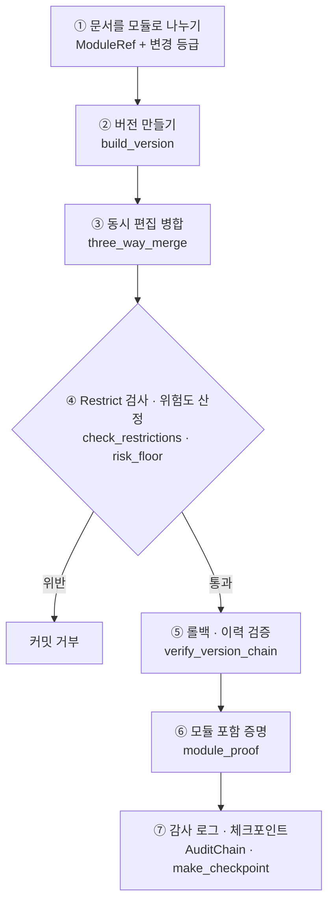
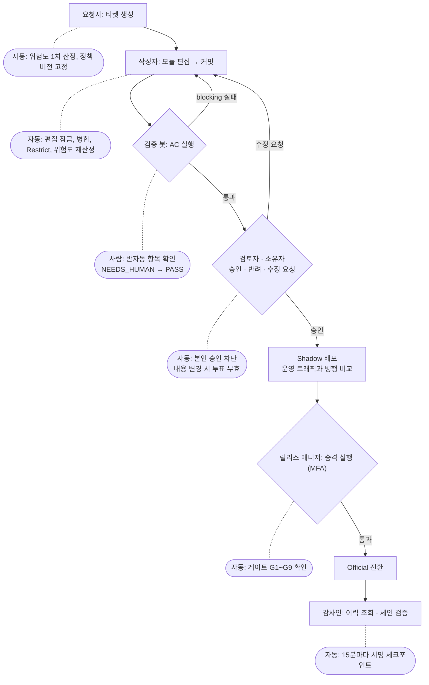
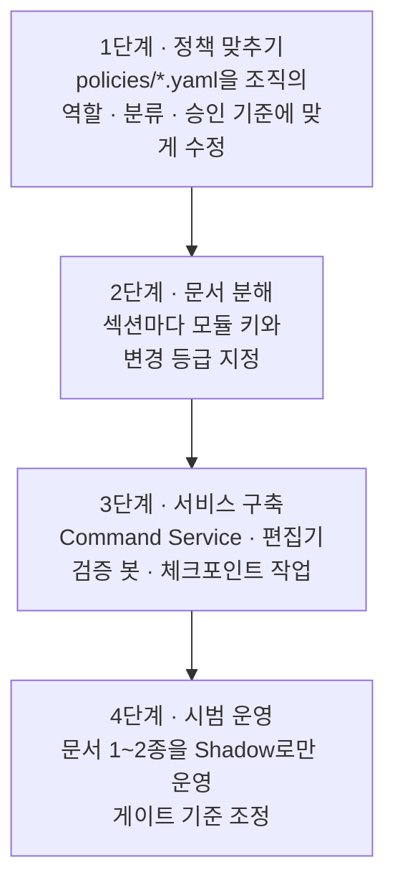

# DMF 사용 가이드

> **현재 상태 안내:** DMF는 지금 **설계와 핵심 라이브러리까지** 만들어져 있습니다.
> 사용자가 접속해서 쓰는 서버·API·화면은 아직 없습니다.
> 이 문서는 ① 지금 바로 쓸 수 있는 방법과 ② 서비스 완성 후의 사용 흐름을 나눠 설명합니다.
>
> 도형은 Mermaid로 작성되어 있습니다. VSCode 미리보기에서는 `Markdown Preview Mermaid Support` 확장이 필요합니다.

---

## 1. 현재 구성 요소

| 구분       | 항목                                                       | 상태                                 |
| ---------- | ---------------------------------------------------------- | ------------------------------------ |
| 라이브러리 | 무결성 라이브러리 `src/dmf_integrity` (Python)           | ✅ 사용 가능, 테스트 18개 통과       |
| 스키마     | `schema/postgres/001_core.sql`                           | ✅ 구문 검증 완료 · ⏳ 실DB 적용 전 |
| 정책       | `policies/*.yaml`, `policies/authz.cedar`              | ✅ 작성 완료 · ⏳ Cedar CLI 검증 전 |
| 서비스     | Command/Query 서비스 (REST API)                            | ❌ 미구현                            |
| 화면       | 웹 편집기 / CLI                                            | ❌ 미구현                            |
| 자동화     | 검증 봇, Shadow 비교기, Temporal 워크플로, 체크포인트 작업 | ❌ 미구현                            |

---

## 2. 지금 사용하는 방법: 라이브러리



공통 준비:

```bash
cd DMF
PYTHONPATH=src python3        # 외부 의존성 없음 (Python 3.9+)
```

```python
from dmf_integrity import *

M = Mutability.MUTABLE
R = Mutability.RESTRICTED
C = Mutability.IMMUTABLE_CORE

def m(id, order, text, mut=M, deps=()):
    return ModuleRef(id, "section", mut, order,
                     content_sha256(text.encode()), tuple(deps))
```

### ① 문서를 모듈로 나누기

| 변경 등급          | 의미                             | 위험도 하한                   |
| ------------------ | -------------------------------- | ----------------------------- |
| `IMMUTABLE_CORE` | 절대 변경 불가 (핵심 규칙·정의) | R3, `CORE_AMENDMENT` 티켓만 |
| `RESTRICTED`     | 수정 가능하지만 승인 강화        | R2                            |
| `MUTABLE`        | 자유롭게 수정                    | R1                            |

```python
base = [m("core.rules", 0, "규칙", C),
        m("sec.intro",  1, "서론"),
        m("sec.scope",  2, "범위", R, ["core.rules"])]
# sec.scope는 core.rules에 의존
```

### ② 버전 만들기

```python
v1 = build_version("doc-1", 1, None, base, {"dc:title": "보안 정책"})
v1.manifest_root   # 내용 전체를 나타내는 해시 (내용 식별자)
v1.version_hash    # 이전 버전과 연결된 해시 (이력 식별자)
```

### ③ 동시 편집 병합

앨리스는 서론을, 밥은 범위를 같은 시점(v1)에서 고쳤다고 가정합니다.

```python
alice = [base[0], m("sec.intro", 1, "서론 수정"), base[2]]
bob   = [base[0], base[1],
         m("sec.scope", 2, "범위 수정", R, ["core.rules"])]

r = three_way_merge(base, alice, bob)
r.clean       # True  → 서로 다른 모듈이므로 자동 병합
r.conflicts   # 같은 모듈을 고쳤다면 여기에 담김 → 충돌 해결 티켓
```

### ④ Restrict 검사와 위험도 산정 (커밋 전 필수)

```python
# [] → 위반 없음
check_restrictions(base, r.modules)

# 2 → RESTRICTED 모듈 수정 → 승인 2명
risk_floor(base, r.modules)

bad = [m("core.rules", 0, "규칙 변경", C)] + base[1:]
# [Violation(code='CORE_MODIFIED', ...)] → 커밋 거부
check_restrictions(base, bad)
```

| 위반 코드                                             | 의미                                     |
| ----------------------------------------------------- | ---------------------------------------- |
| `CORE_MODIFIED` / `CORE_REMOVED` / `CORE_ADDED` | 불변 코어 변경·삭제·추가               |
| `CORE_DOWNGRADED`                                   | 불변 코어의 등급을 낮춤                  |
| `SEAL_MISMATCH`                                     | 불변 영역 봉인(`restrict_seal`) 불일치 |
| `DANGLING_DEPENDENCY`                               | 의존 대상 모듈이 없음                    |
| `DEPENDENCY_CYCLE`                                  | 모듈 간 순환 의존                        |

### ⑤ 롤백과 이력 검증

롤백은 과거를 지우지 않고, **과거 내용을 가진 새 버전**을 만듭니다.

```python
v2 = build_version("doc-1", 2, v1, r.modules, v1.metadata)
# v1 내용으로 롤백 = v1의 모듈 목록으로 새 버전 생성
v3 = build_version("doc-1", 3, v2, v1.modules, v1.metadata)

verify_version_chain([v1, v2, v3])  # 중간 버전이 변조되면 예외

v3.manifest_root == v1.manifest_root  # True: 내용 복원
v3.version_hash  == v1.version_hash   # False: 롤백 기록
```

### ⑥ 모듈 포함 증명

문서 전체를 보내지 않고, 특정 모듈이 그 버전에 들어 있음을 증명합니다.

```python
idx, size, path = module_proof(v2.modules, "sec.scope")
# 받는 쪽: 모듈 + (idx, size, path) + 서명된 manifest_root 로 검증
```

### ⑦ 감사 로그와 체크포인트

```python
chain = AuditChain("urn:dmf:doc:doc-1")
chain.append(occurred_at="2026-11-11T00:00:00Z",
             actor="urn:dmf:agent:alice", action="version.commit",
             target="urn:dmf:version:doc-1/2", ticket_id="DMF-1")
verify_chain(chain.entries)    # 수정·삭제·누락 시 위치(seq)까지 알려줌
```

> 체크포인트 서명에 쓰는 `HmacDevSigner`는 **개발용**입니다. 운영에서는 KMS/HSM 기반 Ed25519 서명기를 사용합니다.

### DB 스키마 적용

```bash
# PostgreSQL 16 이상
psql -v ON_ERROR_STOP=1 -f schema/postgres/001_core.sql
```

> 실제 DB에 적용해 본 적은 아직 없습니다 (구문 검증만 완료).

---

## 3. 서비스 완성 후 사용 흐름 (목표 설계)



| 역할            | 하는 일                          | 필요한 권한                          |
| --------------- | -------------------------------- | ------------------------------------ |
| 요청자          | 티켓 생성                        | 문서 열람                            |
| 작성자          | 모듈 편집, 커밋                  | `editor` (제한 모듈은 문서 소유자) |
| 검토자 / 소유자 | 승인 · 반려 · 수정 요청        | `reviewer`, `document_owner`     |
| 컴플라이언스    | 반자동 검증 항목 확인            | `compliance`                       |
| 거버넌스 위원회 | 불변 코어 변경 승인              | `governance_board` + MFA           |
| 릴리스 매니저   | Official 승격                    | `release_manager` + MFA + 신뢰 IP  |
| 감사인          | 이력 조회, 체인·체크포인트 검증 | 읽기 전용                            |

### 위험도별 승인 기준

| 등급 | 예시                       | 승인 인원 | 추가 조건                             | Shadow 관찰 기간 |
| ---- | -------------------------- | --------- | ------------------------------------- | ---------------- |
| R0   | 공개 문서의 오타 수정      | 0 (자동)  | 검증 통과                             | 없음             |
| R1   | 일반 문서 수정, 병합, 롤백 | 1         | 본인 승인 금지                        | 1시간            |
| R2   | 제한 모듈, 기밀 문서       | 2         | 문서 소유자 포함                      | 24시간           |
| R3   | 불변 코어, 정책 변경       | 3         | 24시간 대기, 2개 부서 이상, 위임 금지 | 3일              |

---

## 4. 조직에 도입하는 순서



---

## 관련 문서

| 문서                              | 내용                              |
| --------------------------------- | --------------------------------- |
| [README.md](../README.md)          | 전체 개요                         |
| [ARCHITECTURE.md](ARCHITECTURE.md) | 상세 설계, 규칙 I-x · H-x        |
| [policies/](../policies/)          | 승인·제약·검증·승격·권한 정책 |
